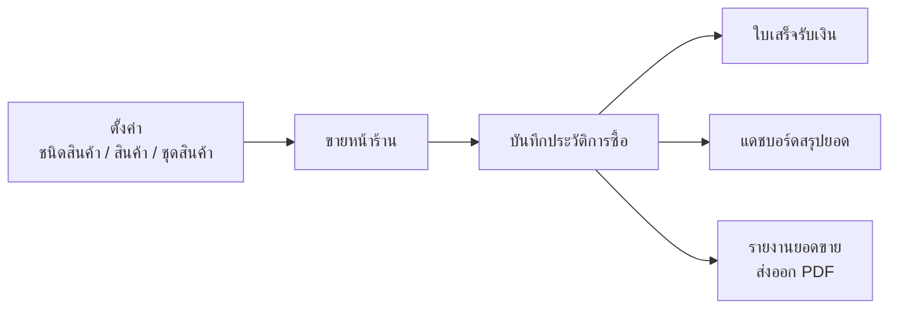
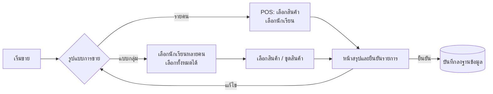
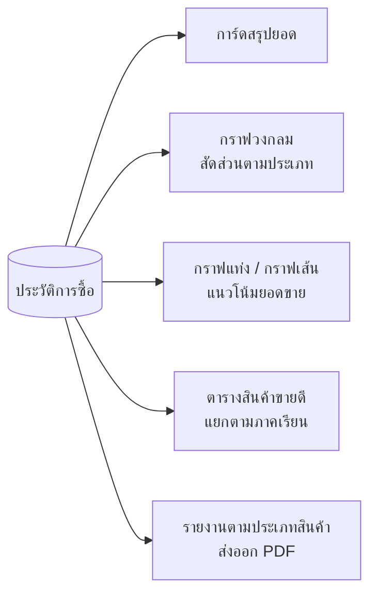

# School Cooperative POS (Case Study)

ระบบขายหน้าร้าน (Point of Sale) และรายงานยอดขาย สำหรับร้านค้าสหกรณ์ที่ขายสินค้าให้นักเรียน รองรับการขายรายคนและการขายแบบกลุ่ม การจัดการสินค้าและชุดสินค้า แดชบอร์ดสรุปยอดขาย และรายงานแบบส่งออก PDF

**สถานะ:** ส่งมอบให้ลูกค้าใช้งานจริง ผมนำขึ้น server และสอนผู้ใช้งานของลูกค้าใช้ระบบ
**ลักษณะงาน:** โปรเจกต์ทีมช่วงฝึกงาน (ผู้พัฒนา 6 คน, มิ.ย.–ส.ค. พ.ศ. 2565 (2022)) ผมรับผิดชอบหลายโมดูลตามด้านล่าง
**โค้ด:** อยู่ใน private repository ยินดีอธิบายเชิงเทคนิคในการสัมภาษณ์

---

## ส่วนที่ผมรับผิดชอบ (ประมาณ 74 commit ในช่วงฝึกงาน)

- **จัดการชนิดสินค้าและสินค้า:** เพิ่ม แก้ไข ค้นหา มีการตรวจข้อมูล (validation) และรหัสสินค้าที่สร้างให้อัตโนมัติแต่แก้ไขได้
- **ชุดสินค้า (template):** จัดชุดสินค้าและสินค้าแบบเดี่ยว เพื่อให้ขายเป็นชุดได้
- **ระบบขายหน้าร้าน (POS):** บันทึกการขายลงฐานข้อมูล พร้อมหน้าสรุปและยืนยันรายการก่อนบันทึก
- **ขายแบบกลุ่ม:** เลือกนักเรียนหลายคนในครั้งเดียว (เลือกทั้งหมดได้) แล้วบันทึกการขายพร้อมกัน
- **แดชบอร์ด (ทั้งหน้าจอและ query หลังบ้าน):** การ์ดสรุปยอด กราฟวงกลม กราฟแท่ง กราฟเส้น และตารางสินค้าขายดีที่แยกตามภาคเรียน
- **รายงาน:** รายงานยอดขายตามประเภทสินค้า และส่งออกเป็น PDF
- **ปรับปรุงหน้าตารางใช้งานจริง:** ตรึงหัวตารางขณะเลื่อนหน้าจอ, ตารางค้นหา/เรียงลำดับ (DataTables), ดักข้อมูลว่าง (NULL) และกรณีไม่ได้เลือกข้อมูล
- **ส่งมอบงาน:** นำระบบขึ้น server และสอนการใช้งานให้ผู้ใช้ของลูกค้า

## ขั้นตอนการทำงานของระบบ

### ภาพรวม

### การขายสินค้า

### แดชบอร์ดและรายงาน

## เทคโนโลยี

PHP (CodeIgniter 3), MySQL, Bootstrap 4, jQuery, DataTables, Select2, SweetAlert2, Chart.js, Git (ทำงานร่วมกับทีมผ่าน branch และ merge)

## ข้อมูลหลักของระบบ

สินค้า, ชนิดสินค้า, ชุดสินค้าและรายการสินค้าในชุด, ประวัติการซื้อ, ใบเสร็จรับเงิน (ทีมต่อยอดเรื่องใบเสร็จในปี พ.ศ. 2566 (2023))

## สิ่งที่ได้เรียนรู้

- ทำระบบตั้งแต่โจทย์จนถึงใช้งานจริง รวมถึง deploy และสอนผู้ใช้ที่ไม่ใช่สายเทคนิค
- ออกแบบข้อมูลและรายงานให้ตอบโจทย์งานขายหน้าร้าน (แยกตามภาคเรียน ตามประเภทสินค้า)
- ใช้ Git ทำงานเป็นทีมเป็นครั้งแรก รวมถึงการแก้ไข conflict และการรวม (merge) งาน
